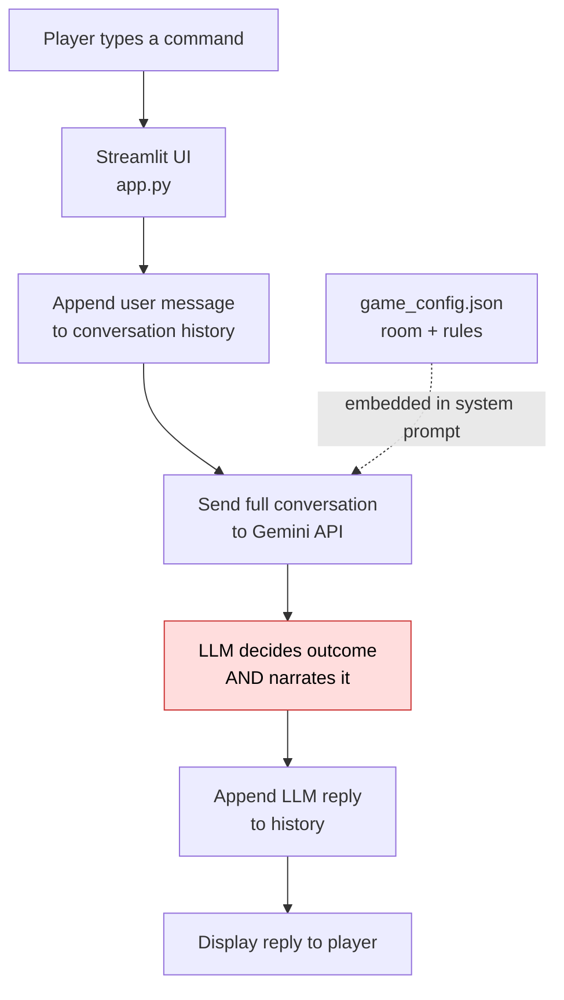
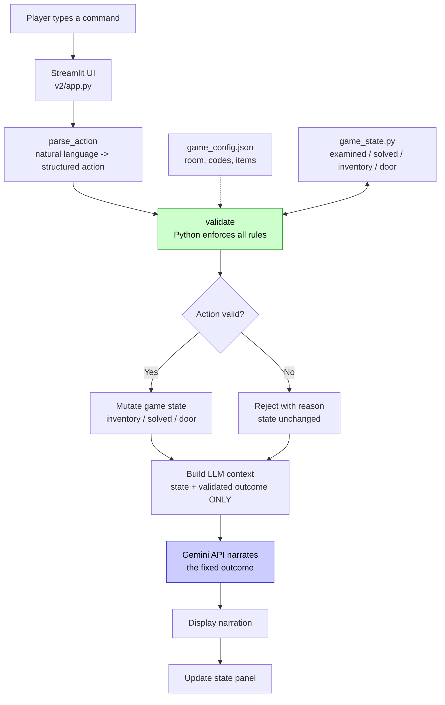

# AI Escape Room — Architecture Diagrams

## Version 1 — Interactive AI Escape Room (LLM-driven)

In Version 1 the LLM is the sole authority. The room description, all
objects, puzzle solutions, and the win condition are stuffed into the
**system prompt**. The LLM both *decides* whether an action succeeds and
*narrates* the result. There is no structured game state — the only
"memory" is the conversation history.

**Characteristics**
- Simple to build.
- No structured state: the LLM must remember everything from the chat.
- The LLM can forget prior actions, invent objects, reveal clues early,
  or be persuaded to unlock the door (prompt injection).
- Outcomes are non-deterministic and cannot be unit-tested.

---

## Version 2 — Reliable AI Escape Room (Validated State + LLM Narration)

In Version 2 the game rules and state live in **Python**, not the LLM.
The player's input is parsed into a structured action, validated against
the current state by `action_validator.py`, and only the *validated
outcome* is handed to the LLM for narration. The LLM cannot change the
result.

**Characteristics**
- Deterministic validation: codes, keys, inventory, and the win
  condition are checked by Python.
- The LLM is a *narrator*, not an *arbiter*. It cannot unlock the door
  or reveal codes because those facts never enter its prompt.
- Full state is visible in the sidebar and can be serialized for tests.
- Adversarial inputs (admin impersonation, code guessing, claiming
  puzzles are solved) are rejected before the LLM sees them.

---

## Component Summary

| Component | File | Version | Role |
|---|---|---|---|
| Game config | `shared/game_config.json` | 1 & 2 | Room, objects, items, puzzle solutions, door code |
| LLM client | `shared/llm_client.py` | 1 & 2 | Gemini API wrapper |
| V1 app | `v1/app.py` | 1 | LLM-as-Game-Master, no validation |
| Game state | `v2/game_state.py` | 2 | Structured state dict + serialization |
| Action validator | `v2/action_validator.py` | 2 | parse + validate + outcome (all rules) |
| V2 app | `v2/app.py` | 2 | UI that calls validator then LLM narrator |
| Tests | `tests/test_escape_room.py` | 2 | 8 deterministic test cases |
